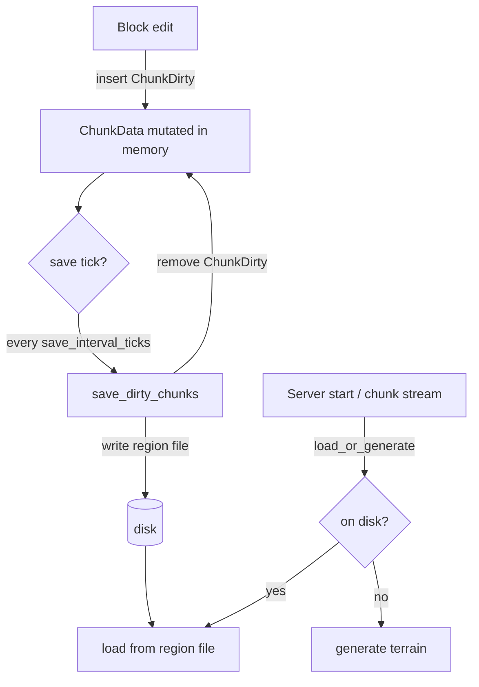

# World Serialization

VoidMC can persist modified chunks to disk and reload them on startup. This is
provided by the **`voidmc-world-io`** crate as an opt-in plugin, so the core
engine stays free of any storage dependencies.

When enabled:

- Block edits already mark their chunk with the `ChunkDirty` component. A save
  system periodically writes every dirty chunk to disk and clears the marker.
- On startup (and whenever a chunk is streamed for the first time) the engine
  loads the chunk from disk **before** falling back to the world generator.
- On shutdown — `/stop`, Ctrl-C, or SIGTERM, all of which emit `AppExit` — every
  remaining dirty chunk is flushed before the server exits.

## Enabling persistence

Add the dependency and install `WorldPersistencePlugin` via `add_plugin`:

```toml
# Cargo.toml
voidmc-world-io = { version = "0.1.0", path = "../void-world-io" }
```

```rust
use voidmc::{ServerConfigBuilder, VoidServer};
use voidmc_world_io::{PersistenceConfig, WorldPersistencePlugin};

VoidServer::new(ServerConfigBuilder::new().build())
    .add_plugin(|app| {
        app.add_plugins(WorldPersistencePlugin::new(
            PersistenceConfig::new("world").save_interval_ticks(200),
        ));
    })
    .run();
```

The plugin must be added before the server runs (the example above does this via
`add_plugin`), so the chunk loader is installed before the spawn area is
generated.

## Configuration

`PersistenceConfig` controls where and how chunks are stored:

| Field | Type | Default | Description |
|---|---|---|---|
| `directory` | `PathBuf` | `"world"` | Root world directory; region files live under `<dir>/region/` |
| `save_interval_ticks` | `u64` | `200` | Ticks between periodic flushes of dirty chunks |
| `enabled` | `bool` | `true` | Master switch; when `false` the plugin installs nothing |
| `regenerate_light_on_load` | `bool` | `false` | Skip persisting light and regenerate full sky light on load (smaller files) |
| `max_saves_per_flush` | `usize` | `0` | Cap chunks written per save tick (`0` = unlimited) |

Builder-style setters are available:

```rust
PersistenceConfig::new("world")
    .save_interval_ticks(400)
    .regenerate_light_on_load(true)
    .max_saves_per_flush(64);
```

## On-disk format

Chunks are grouped into **region files** at
`<directory>/region/<dimension>/r.<rx>.<rz>.vrm`, where `rx = chunk_x >> 5` and
`rz = chunk_z >> 5` (32×32 chunks per file). The layout is modeled on
Minecraft's Anvil `.mca` format but is **not** vanilla-compatible:

- A two-sector (8 KiB) header holds 1024 location entries
  (`offset << 8 | sector_count`) and 1024 timestamps.
- Each chunk payload is `[u32 length][u8 compression][zlib data]`, padded to a
  4096-byte sector boundary.
- The payload is a standard (named-root) NBT compound built with `ussr_nbt`,
  mirroring VoidMC's chunk types: per-section `block_count`, `block_states`
  (single value or `bits` + `palette` + packed `data`), `biome`, plus
  `heightmaps`, an Anvil-shaped `block_entities` list (`id`, `x`, `y`, `z`
  and the entity's own tags) and (optionally) `light`.

## Lifecycle



The `ChunkDirty` marker is removed only after a **successful** write, so a failed
save is retried on the next interval. Loaded chunks are inserted exactly like
generated ones and are not marked dirty (they already match disk).

`save_dirty_chunks` runs in `PostUpdate` after `VoidSystems::BlockEntitySync`,
which marks the chunks whose block entities changed. A block-entity change
made later in the tick is marked in the next tick and saved by a later save.

## Damaged chunks

A stored chunk that cannot be loaded is **generated again**, so that players are
not stuck, but its stored bytes are never silently lost:

- **Undecodable** (the bytes were read, but the length, the compression or the
  NBT inside are wrong): before the chunk is generated, the sectors that hold
  it are copied, exactly as found on disk, to a **quarantine file** next to its
  region file. Saves of the chunk then go on as usual: the first edit marks it
  dirty and the next save writes the new chunk over the damaged one.
- **Unreadable** (an I/O error, so there is nothing to copy), or undecodable
  but the copy failed: the chunk is generated for play, but **every save of it
  is skipped until the server stops** (logged as a warning), so the stored
  bytes stay as they are. Edits made to it in that session are lost.

Either way the server logs an error naming the chunk and what it did, triggers
a [`ChunkLoadFailedEvent`](/reference/server/events#world-storage) and counts
the failure in `voidmc_chunk_load_errors_total{kind="decode"|"io"}` on the
[metrics endpoint](/reference/server/observability#errors).

```rust
use voidmc::{ChunkLoadFailedEvent, DamagedChunkAction, On};

app.add_observer(|event: On<ChunkLoadFailedEvent>| {
    let pos = event.pos;
    match &event.action {
        DamagedChunkAction::Quarantined(path) => {
            tracing::warn!(?pos, path = %path.display(), "chunk regenerated, old data kept");
        }
        DamagedChunkAction::SavesSkipped => {
            tracing::warn!(?pos, "chunk regenerated, its saves are skipped");
        }
    }
});
```

### Quarantine files

A quarantine file is written to
`<directory>/region/<dimension>/c.<cx>.<cz>.<n>.corrupt`, where `cx` and `cz`
are the chunk coordinates (not the region's) and `n` is the lowest number from
`1` that no file of that chunk has yet. The file is created only if no file has
that name and is synced to disk before the chunk is generated. The server never
overwrites nor deletes a quarantine file: a later failure of the same chunk
gets the next number.

It holds the chunk's sectors as the region file's location table gave them:
`[u32 length][u8 compression][zlib data]` and the zero padding to the sector
boundary, damaged as they were. To recover what can be recovered, stop the
server and work on a copy:

- skip the 5-byte prefix and inflate the rest (`tail -c +6 c.1.0.1.corrupt |
  zlib-flate -uncompress`, or any zlib library that returns partial output)
  to get the chunk's NBT, or as much of it as survived;
- inspect or repair that NBT with any NBT tool, and rebuild the chunk in game
  (for example with world edit) or write it back with your own
  `RegionChunkStore::write` call.

Once you no longer need it, delete the file yourself.

A custom `ChunkStore` keeps such copies by implementing `ChunkStore::quarantine`;
without it, an undecodable chunk is treated like an unreadable one and its saves
are skipped for the session.

## Custom storage backends

`WorldPersistencePlugin::new` uses the built-in region-file store. To plug in a
different backend (database, object store, test double), implement
[`ChunkStore`](#) and pass it explicitly:

```rust
use std::sync::Arc;
use voidmc_world_io::{ChunkStore, PersistenceConfig, WorldPersistencePlugin};

let store: Arc<dyn ChunkStore> = Arc::new(MyStore::new());
app.add_plugins(WorldPersistencePlugin::with_store(
    PersistenceConfig::new("world"),
    store,
));
```

The engine-facing hook is the `voidmc::ChunkLoader` trait (with the
`ChunkLoaderResource` it is installed as); `voidmc-world-io` provides a
`StoreLoader` adapter that bridges any `ChunkStore` to it.

`ChunkStore::read` reports bytes it cannot read as `PersistenceError::Io` and
bytes it read but cannot decode as `PersistenceError::Corrupt`: the loader
handles the two as described in [Damaged chunks](#damaged-chunks).

## Limitations

- The format is **not** compatible with the vanilla Minecraft client or other
  servers; it only round-trips VoidMC's own chunk data.
- Persistence is chunk-granular: a chunk is saved as a whole when any block in
  it changes. Entities are not yet persisted; block entities are saved with
  their chunk.
- A chunk modified in memory but never flushed (e.g. on a hard `kill -9`) may be
  lost; periodic and shutdown flushes cover the normal cases.

## See also

- [Chunk protocol spec](/reference/protocol-specs/v26.1.2/chunks)
- [Server configuration](/reference/server/configuration)
- [ECS components & resources](/reference/server/ecs)
